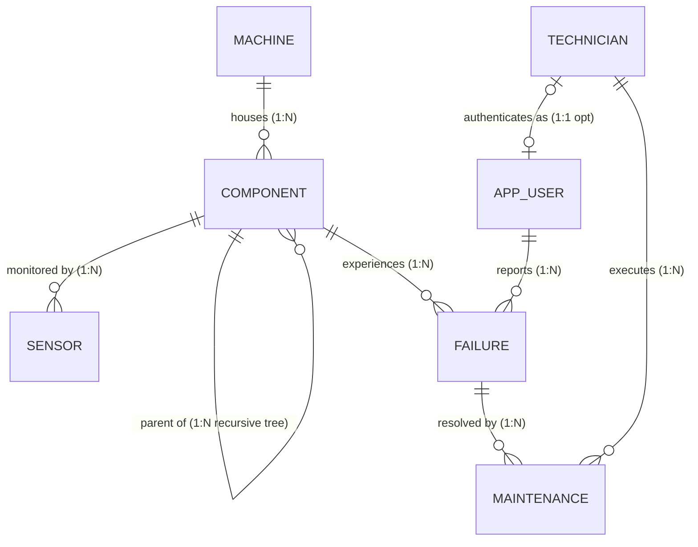

# Industrial Maintenance Knowledge & Failure Traceability System

**PES University · Department of Computer Science & Engineering (AI & ML)**  
**Course:** UE23CS351A – Database Management Systems (DBMS) | Experiential Learning Level 3 (Aug – Dec 2025)

### Authors / Team Members
- **Kshitij Satish Shetty** (SRN: `PES1UG24AM143`, 5th Sem – Section C)
- **Mallikarjuna Rao RV** (SRN: `PES1UG24AM155`, 5th Sem – Section C)

---

## 📌 Project Overview

In industrial environments, unexpected machine breakdowns cause catastrophic production bottlenecks. While technicians routinely troubleshoot mechanical, hydraulic, and electrical faults, historical diagnostic expertise remains locked away in unstructured text logs. When similar failures recur, technicians repeat diagnostics from scratch.

The **Industrial Maintenance Knowledge & Failure Traceability System** is a unified multi-paradigm database platform designed to eliminate diagnostic latency:
1. **Relational Core (PostgreSQL 16):** 3NF master data model enforcing strict referential integrity, check constraints, procedural business logic (triggers, stored procedures, views), and native database-level Role-Based Access Control (RBAC).
2. **Flexible Telemetry Store (MongoDB 7):** Ingests irregular, polymorphic sensor telemetry streams (vibration tri-axial RMS, temperature, hydraulic pressure) with real-time aggregation.
3. **Semantic Vector Knowledge Base (ChromaDB):** Embeds failure symptoms and proven corrective actions into 384-dimensional dense vectors to provide instant semantic similarity search as technicians type descriptions.
4. **Reactive Web Interface (Next.js 14 & FastAPI):** Real-time interactive dashboard featuring debounced live troubleshooting hints, telemetry visualization, automated workload-balanced dispatching, and role-gated administrative workflows.

---

## 📑 Project Report & Deliverables

The complete, submittable academic report has been compiled and verified against all course rubrics:
- **Formal Academic Report (PDF):** [`DBMS_Project_Report.pdf`](./DBMS_Project_Report.pdf) *(56 pages, Times New Roman 12 pt, justified, 35+ embedded figures)*
- **Editable Report Document (Word):** [`DBMS_Project_Report.docx`](./DBMS_Project_Report.docx) *(4.47 MB, styled with native Word tables, callouts, and captions)*
- **Markdown Report Version:** [`DBMS_Project_Report.md`](./DBMS_Project_Report.md)

---

## 🏛️ Tri-Database Architecture

| Layer | Technology | Primary Function & Data Held | Key DBMS Concepts |
| :--- | :--- | :--- | :--- |
| **Relational Core** | **PostgreSQL 16** | Machines, sub-assemblies, sensors, technicians, users, failures, maintenance | 3NF/BCNF normalization, PK/FK cascades, CHECK constraints, Triggers, Stored Procedures, Views, DB-level RBAC (`role_admin`, `role_technician`) |
| **NoSQL Telemetry** | **MongoDB 7** | High-frequency IoT sensor telemetry (`maintenance_logs.readings`) | Dynamic schema, polymorphic JSON documents (`data.axis`, `data.rms`, `data.ambient`), PyMongo CRUD, Aggregation pipeline (`$group`, `$avg`, `$max`) |
| **Vector DB** | **ChromaDB** | Semantic failure memory (`failure_reports` collection in `chroma_store`) | Dense vector embeddings, cosine distance nearest-neighbor queries, semantic search, Vector Update & Delete |
| **Backend API** | **FastAPI + JWT** | REST API gateway, database connection pooling, role verification | Connection pool routing by DB login (`app_admin` / `app_tech`), PBKDF2 password hashing, async execution |
| **Frontend UI** | **Next.js 14 (React 18)** | Reactive single-page dashboard, live hints, sensor views, admin panel | Client-side debounced queries, dynamic badge indicators, role-gated UI components |
| **Orchestration** | **Docker Compose** | PostgreSQL 16 & MongoDB 7 automated deployment | Volume mounting for automatic SQL script execution (`db/*.sql`) |

---

## 📐 Entity-Relationship (ER) Diagram



### Relational Schema (3NF Normalization)
1. **`technician`** (**`tech_id`**, `name`, `email`, `specialization`)
2. **`app_user`** (**`user_id`**, `username`, `password_hash`, `role`, `tech_id` &rarr; `technician.tech_id`)
3. **`machine`** (**`machine_id`**, `name`, `location`, `install_date`, `status`)
4. **`component`** (**`component_id`**, `machine_id` &rarr; `machine.machine_id`, `parent_component_id` &rarr; `component.component_id`, `name`)
5. **`sensor`** (**`sensor_id`**, `component_id` &rarr; `component.component_id`, `sensor_type`, `unit`)
6. **`failure`** (**`failure_id`**, `component_id` &rarr; `component.component_id`, `reported_by` &rarr; `app_user.user_id`, `symptom_description`, `severity`, `status`, `reported_at`, `resolved_at`)
7. **`maintenance`** (**`maintenance_id`**, `failure_id` &rarr; `failure.failure_id`, `tech_id` &rarr; `technician.tech_id`, `action_taken`, `cost`, `started_at`, `completed_at`)

> **Note on ER-to-Relational Mapping:** `maintenance` serves as an associative relation that resolves the conceptual M:N relationship between `failure` and `technician`, preserving operational attributes (`action_taken`, `cost`, timestamps).

---

## ⚡ Advanced Database Concepts Implemented

- **Stored Function:** `fn_open_failures(p_machine INT) RETURNS INT` – Stable function returning active non-resolved failures for any machine.
- **Stored Procedure 1 (Auto-Dispatch):** `sp_assign_technician(p_failure INT, p_tech INT, INOUT p_maint INT)` – Dynamically load-balances tickets to the technician with the fewest active assignments.
- **Stored Procedure 2 (Atomic Closure):** `sp_close_ticket(p_maint INT, p_action TEXT, p_cost NUMERIC)` – Atomically records resolution notes, cost, and marks failure as `RESOLVED`.
- **Triggers & Trigger Chaining:**
  - `trg_failure_status` (on `failure`): Synchronizes `machine.status` (`FAULTY` on OPEN &rarr; `UNDER_MAINTENANCE` on IN_PROGRESS &rarr; `RUNNING` when all resolved).
  - `trg_maintenance_insert` (on `maintenance`): Inserting a maintenance record shifts the failure from `OPEN` to `IN_PROGRESS`, which chains into `trg_failure_status` to put the machine into `UNDER_MAINTENANCE`.
- **Analytical Views:**
  - `v_open_failures_per_machine`: Real-time machine health and active open failure count.
  - `v_technician_workload`: Technician active vs. completed ticket tallies.
- **Analytical SQL Queries (`db/queries/demo_queries.sql`):**
  - Multi-table **JOIN** linking failures, components, machines, and maintenance actions.
  - **Nested Subquery** (`IN`) filtering machines with `HIGH` or `CRITICAL` severity faults.
  - **Correlated Subquery** identifying components with failure counts exceeding their machine average.
  - **Recursive CTE** traversing hierarchical component sub-assemblies with indentation depth.
  - **Window Function** (`RANK() OVER (PARTITION BY machine_id ORDER BY total DESC)`) calculating component repair cost rankings.
  - **Set Operation** (`EXCEPT`) detecting machines operating with zero open issues.
- **Defense-in-Depth RBAC:**
  - PostgreSQL Roles: `role_admin` (full privileges) vs. `role_technician` (SELECT on public, INSERT/UPDATE on `failure`/`maintenance`, zero access to `app_user`, no master data modification).
  - FastAPI routes requests through dedicated connection pools logging in as `app_admin` or `app_tech`.

---

## 🚀 Getting Started

### 1. Prerequisites
- [Docker Desktop](https://www.docker.com/products/docker-desktop/) installed and running.
- Python 3.10+ (with `venv`).
- Node.js 18+ and `npm`.

### 2. Launch Databases with Docker Compose
```bash
docker compose up -d
```
*This automatically boots PostgreSQL 16 (on port `5432`) and MongoDB 7 (on port `27017`), executing `db/01_schema.sql`, `db/02_logic.sql`, and `db/03_seed.sql` on initialization.*

### 3. Start the FastAPI Backend
```bash
cd backend
python -m venv venv

# Windows PowerShell:
.\venv\Scripts\Activate.ps1
# Linux / macOS:
# source venv/bin/activate

pip install -r requirements.txt
uvicorn main:app --reload --port 8000
```
- API Base URL: `http://localhost:8000`
- Interactive Swagger Documentation: `http://localhost:8000/docs`
*(On initial startup, default users are generated, sensor telemetry is seeded, and ChromaDB downloads a lightweight embedding model to index historical failures.)*

### 4. Start the Next.js Frontend
```bash
cd frontend
npm install
npm run dev
```
- Open application at: `http://localhost:3000`

### 🔑 Demo Login Credentials
| Role | Username | Password | Permissions & Scope |
| :--- | :--- | :--- | :--- |
| **Plant Administrator** | `admin` | `admin123` | Full access: Add machines, components, technicians, delete sensor logs, remove vector records |
| **Field Technician** | `tech1` | `tech123` | Operational access: View telemetry, log failures, view live semantic hints, close assigned tickets |

---

## 🗂️ Project Directory Structure

```
maintenance-traceability/
├── docs/                        # Formal project reports & documentation
│   ├── DBMS_Project_Report.pdf  # 56-page formal academic report (PDF)
│   ├── DBMS_Project_Report.docx # Academic report source document (Word)
│   └── DBMS_Project_Report.md   # Markdown report source
├── docker-compose.yml           # PostgreSQL 16 & MongoDB 7 container setup
├── README.md                    # Project documentation & quickstart guide
├── db/                          # Database schemas, migrations & queries
│   ├── 01_schema.sql            # DDL: Tables, constraints, indexes
│   ├── 02_logic.sql             # PL/pgSQL functions, procedures, triggers, views, RBAC roles
│   ├── 03_seed.sql              # Initial seed data for machines, components, technicians
│   └── queries/
│       └── demo_queries.sql     # Advanced queries (JOIN, Nested, Correlated, Recursive CTE, Window)
├── backend/                     # FastAPI Asynchronous REST API
│   ├── main.py                  # Endpoints, DB connection pools, JWT auth, MongoDB & ChromaDB logic
│   ├── requirements.txt         # Dependencies (fastapi, psycopg2, pymongo, chromadb, pyjwt)
│   └── chroma_store/            # Persistent ChromaDB vector storage files
├── frontend/                    # Next.js 14 Reactive Frontend
│   ├── package.json             # Scripts & dependencies (Next.js 14, React 18)
│   └── app/
│       ├── layout.js            # Root layout shell & typography
│       ├── globals.css          # CSS styles, status badges, responsive tables
│       └── page.js              # Complete single-page dashboard & role-gated UI
└── screenshots/                 # 57 Comprehensive documentation screenshots
    ├── 01_Frontend/             # Next.js UI pages, live hints, close forms, dashboards
    ├── 02_PostgreSQL/           # SQL DDL, DML, ERD, Schema diagram, triggers, procedures, views
    ├── 03_MongoDB_ChromaDB/     # MongoDB readings, aggregation, ChromaDB semantic search
    ├── 04_Authentication/       # RBAC tests, login screens, Swagger 401/403 validation
    └── 05_Documentation/        # Docker Compose deployment & project tree structure
```

---

## 📊 Course Rubric Completion Status

| # | Evaluation Criteria | Description | Status & Implementation Evidence |
| :---: | :--- | :--- | :--- |
| **1** | **Database Design** | ER diagram, relational schema with keys, relationships, and constraints | **COMPLETED** · 3NF Relational Model, Strong/Weak entities, Recursive hierarchy, ER Diagram (`02_PostgreSQL/ER_Diagram.png`), and Schema Diagram (`02_PostgreSQL/Schema_Diagram.png`). |
| **2** | **Database Creation** | SQL database implementation - DDL with constraints, NoSQL/Vector database creation, Technology justification | **COMPLETED** · DDL scripts (`db/01_schema.sql`) with PK, FK (CASCADE/SET NULL), CHECK, UNIQUE, DEFAULT; MongoDB `readings` collection; ChromaDB persistent store; full tech stack justification. |
| **3** | **SQL Operations and Queries** | DML operations, Nested/correlated/Recursive SQL queries, Join SQL queries | **COMPLETED** · Validated DML (`S6_dml_*`), Multi-table JOIN (`S6_query_join`), Nested query (`S6_query_nested`), Correlated query (`S6_query_correlated`), Recursive CTE (`S6_query_recursive_cte`), Window `RANK()` (`S6_query_cte_window`), and Set `EXCEPT`. |
| **4** | **Advanced Database Concepts** | Stored procedures, functions, triggers, CTEs, NoSQL/Vector feature RUD | **COMPLETED** · `fn_open_failures`, `sp_assign_technician`, `sp_close_ticket`, Triggers & Chaining (`S8_trigger_chain`), Views (`v_*`), ACID Rollback test (`S8_transaction_rollback`), MongoDB CRUD & Aggregation, ChromaDB Vector RUD. |
| **5** | **Web App & DB Integration** | Next.js interface, Backend/API and database integration | **COMPLETED** · Decoupled Next.js 14 frontend with reactive debounced live hints, FastAPI backend with connection pooling across 3 database engines, Dockerized deployment. |
| **6** | **Authentication & RBAC** | Front-end and backend authentication, minimum two roles, database-level RBAC | **COMPLETED** · PBKDF2 hashing, JWT bearer tokens, `ADMIN` vs. `TECHNICIAN` roles, native PostgreSQL roles (`role_admin`, `role_technician`), Swagger 401/403 tests (`04_Authentication/`). |
| **7** | **Documentation & Testing** | Comprehensive documentation, Git/GitHub, originality, and individual contribution | **COMPLETED** · 56-page formal PDF report, fully documented repository, 57 verified screenshots, high domain originality for industrial knowledge traceability. |

---

## 👥 Individual Contribution Breakdown

| Team Member | SRN | Core Responsibilities & Deliverables |
| :--- | :--- | :--- |
| **Kshitij Satish Shetty** | `PES1UG24AM143` | • Hybrid multi-model database architecture design (PostgreSQL + MongoDB + ChromaDB)<br>• 3NF relational schema design and integrity constraints (`01_schema.sql`)<br>• PL/pgSQL stored procedures, triggers, trigger chaining, views, and DB RBAC (`02_logic.sql`)<br>• FastAPI asynchronous backend gateway, connection pooling, and JWT authentication<br>• ChromaDB dense vector embedding pipeline, cosine similarity query, and vector synchronization<br>• Next.js 14 reactive frontend UI, dashboard metrics, and debounced live-hinting integration |
| **Mallikarjuna Rao RV** | `PES1UG24AM155` | • MongoDB polymorphic IoT telemetry document schema design and PyMongo ingestion scripts<br>• Real-time MongoDB statistical aggregation pipeline (`$group`, `$avg`, `$max`, `$project`)<br>• Multi-container Docker Compose infrastructure orchestration (PostgreSQL 16, MongoDB 7)<br>• Formulation, optimization, and execution of complex analytical SQL queries (JOIN, Nested, Correlated, Recursive CTE, Window function)<br>• ACID transaction rollback validation and boundary constraint verification<br>• Comprehensive testing, screenshot documentation cataloging, and formal report compilation |
