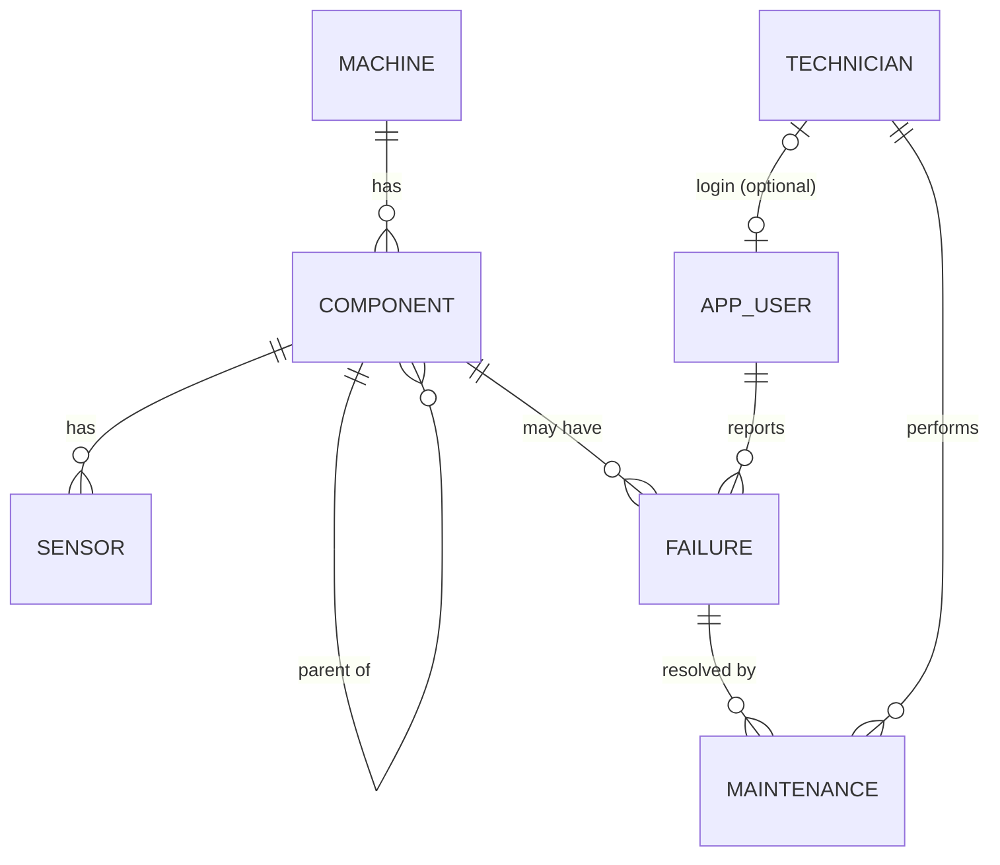

# Industrial Maintenance Knowledge & Failure Traceability System
PES University · DBMS Experiential Learning Level 3 · Author: Kshitij Satish Shetty (PES1UG24AM143, Sec C)

Technicians log machine failures in plain text and instantly see similar past failures and the repairs that fixed them.

## Architecture
| Layer | Tech | Holds |
|---|---|---|
| Relational | PostgreSQL 16 | machines, components, sensors, technicians, users, failures, maintenance (3NF, FKs, CHECKs, triggers, procedures, views) |
| NoSQL | MongoDB 7 | irregular sensor/event readings (fields differ per sensor type) |
| Vector | ChromaDB | embeddings of failure symptoms + repair notes for semantic search |
| Backend | FastAPI + JWT | REST API, role checks, 3 DB connections |
| Frontend | Next.js 14 | login, failure logging, similar-incident search, sensors, admin |

## ER diagram


## Run
```bash
docker compose up -d                      # Postgres (auto-runs db/*.sql) + MongoDB
cd backend && python -m venv venv && source venv/bin/activate
pip install -r requirements.txt && uvicorn main:app --reload     # http://localhost:8000/docs
cd ../frontend && npm install && npm run dev                      # http://localhost:3000
```
Demo logins: `admin / admin123` (Admin), `tech1 / tech123` (Technician). The first backend start seeds users, sensor logs and the vector index. First vector query downloads a small embedding model.

## Where each concept lives
- DDL + constraints: `db/01_schema.sql` · Triggers, functions, procedures, views, **DB roles/GRANTs**: `db/02_logic.sql`
- DML, joins, nested, correlated, recursive CTE, window: `db/queries/demo_queries.sql`
- MongoDB CRUD + aggregation: `/sensors*` in `backend/main.py` · Vector search + update + delete: `/similar`, `/reports/*`
- RBAC: JWT role in API **and** separate PostgreSQL logins (`app_admin`, `app_tech`); technicians cannot DELETE or change master data (DB returns permission denied).
